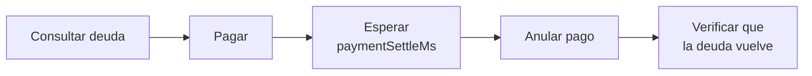

# ihf-multi-channel-payments-api

Regresión E2E de los **canales de pago** (hoy BCP) construida con [Karate](https://github.com/karatelabs/karate).

Dado un cliente con deuda, la regresión recorre el ciclo completo contra la API:



Al terminar, el cliente queda como estaba y puede reutilizarse en la siguiente corrida.

## Contenido

- [Inicio rápido](#inicio-rápido)
- [Requisitos](#requisitos)
- [Configuración](#configuración)
- [Ejecución](#ejecución)
- [Estructura del proyecto](#estructura-del-proyecto)
- [Tags](#tags)
- [Diseño](#diseño)
- [Librerías](#librerías)
- [Comportamiento conocido del backend](#comportamiento-conocido-del-backend)
- [Solución de problemas](#solución-de-problemas)
- [Agregar un canal](#agregar-un-canal-por-ejemplo-interbank)

## Inicio rápido

```bash
# 1. Crea src/test/resources/karate-config-local.json con tus credenciales (ver Configuración)
# 2. Ejecuta la regresión con un DNI que tenga deuda
mvn test -Dkarate.env=test -DcustomerId=27049893
# 3. Abre el reporte: target/karate-reports/karate-summary.html
```

## Requisitos

- Java 21
- Maven 3.9 o superior
- Un cliente (DNI de 8 dígitos) con **deuda pendiente** en el ambiente a probar
- Credenciales de la API de pagos para ese ambiente

## Configuración

Las credenciales **no se guardan en el repositorio**. Crea `src/test/resources/karate-config-local.json` (ignorado por git), con una sección por ambiente:

```json
{
  "test": {
    "API_BASE_URL": "https://api.test.oka.com.pe/v1",
    "PAGOS_USERNAME": "<usuario>",
    "PAGOS_PASSWORD": "<contraseña>"
  }
}
```

### Parámetros

| Parámetro | Obligatorio | Descripción |
|---|:---:|---|
| `karate.env` | Sí | Ambiente a probar: `test`, `stag`… Debe existir como sección en el JSON local |
| `customerId` | Sí | DNI del cliente con deuda (8 dígitos) |
| `API_BASE_URL` | Sí | URL base de la API |
| `PAGOS_USERNAME` / `PAGOS_PASSWORD` | Sí | Credenciales de Basic Auth |
| `operationNumber` | No | Número de operación del pago. Si no se indica, se genera uno único por corrida |
| `paymentSettleMs` | No | Espera en milisegundos entre el pago y la anulación. Por defecto `20000` |
| `tags` | No | Filtro de tags a ejecutar. Por defecto `@regression` (ver [Tags](#tags)) |
| `dryRun` | No | Con `true`, valida los features sin llamar a la API |

### Orden de resolución

Cada valor se busca en este orden y se usa el primero que exista:

1. Propiedad `-D` de Maven (`-DcustomerId=...`)
2. Variable de entorno
3. Sección del ambiente en `karate-config-local.json`

> **Tip:** en CI define `API_BASE_URL`, `PAGOS_USERNAME` y `PAGOS_PASSWORD` como variables de entorno (secretos) en lugar de crear el JSON local.

## Ejecución

```bash
# Regresión completa (todo lo marcado @regression)
mvn test -Dkarate.env=test -DcustomerId=27049893

# Solo un canal
mvn test -Dkarate.env=test -DcustomerId=27049893 -Dtags=@bcp

# Validar los features sin llamar a la API
mvn test -Dkarate.env=test -DdryRun=true

# Ajustar la espera entre pago y anulación, y fijar el número de operación
mvn test -Dkarate.env=test -DcustomerId=27049893 -DpaymentSettleMs=30000 -DoperationNumber=123456
```

`-Dtags` cumple el rol de los perfiles de `cucumber.cjs` en los repos `-qa`.

### Reportes

Quedan en `target/karate-reports/`:

| Archivo | Uso |
|---|---|
| `evidencia-QATEST-1841.html` | Evidencia para el ticket: resumen visual de la corrida (solo se genera si la prueba pasó) |
| `karate-summary.html` | Reporte técnico con cada paso; incluye el `operationNumber` usado, útil para rastrear el pago en el backend |
| JUnit XML | Integración con CI |
| Cucumber JSON | Para subir resultados a Xray |

**Evidencia para Jira:** abre `evidencia-QATEST-1841.html` en el navegador, `Ctrl + P` → **Guardar como PDF** y adjunta el PDF al ticket (Jira previsualiza PDF, no HTML). Guárdala antes de la siguiente corrida: `mvn clean test` borra `target/`. La plantilla está en `features/support/test-evidence-bcp.html`.

## Estructura del proyecto

Sigue el layout de los repos `-qa` (`features/` en la raíz, con `context/` y `support/`), adaptado a Karate:

```
├── features/
│   ├── api_integrations_bcp_e2e.feature   → consultar → pagar → anular → verificar
│   ├── context/
│   │   └── bcp/                           → cuerpos de los requests: inquire, payment, annulment
│   └── support/
│       └── bcp-api.feature                → una operación por endpoint (@ignore)
├── src/test/
│   ├── java/payments/
│   │   └── PaymentsTest.java              → runner único: ejecuta classpath:features filtrando por tags
│   └── resources/
│       ├── karate-config.js               → ambiente, credenciales y funciones auxiliares
│       └── karate-config-local.json       → credenciales locales (no versionado)
├── AGENTS.md / CLAUDE.md                  → instrucciones para agentes IA
└── pom.xml                                → copia features/ a classpath:features
```

| Ubicación | Contenido |
|---|---|
| `features/*.feature` | Lo que se ejecuta. Nombre: `api_<recurso>_<método\|e2e>.feature`, como en los `-qa` |
| `features/context/` | Datos (JSON con expresiones `#(...)`), separados de la lógica |
| `features/support/` | Piezas reutilizables con `@ignore`; nunca se ejecutan solas |

## Tags

| Tag | Dónde | Uso |
|---|---|---|
| `@regression` | Scenario | Flujo completo; es lo que corre por defecto |
| `@bcp`, `@interbank`… | Feature | Filtrar por canal |
| `@QATEST-XXX` | Feature (épica) y Scenario (caso) | Llave de Xray, igual que en los `-qa`. Agregar cuando exista el ticket |

## Diseño

- **API Object:** `bcp-api.feature` encapsula cada endpoint (URL y autenticación) y lee el cuerpo desde `context/bcp/`. La regresión no conoce URLs ni JSON: llama a `@name=inquire`, `@name=payment` y `@name=annulment`.
- **Composición con `call read(...)`:** es la forma de reutilizar en Karate y reemplaza a los step definitions de Cucumber.
- **Datos separados de la lógica:** los cuerpos de request viven en `features/context/`.
- **Configuración externalizada:** ambientes y secretos viven fuera del código, resueltos en `karate-config.js`.
- **Reintento (`retry until`):** la verificación final reconsulta hasta que la deuda vuelve.
- **Datos únicos:** cada corrida genera su propio `operationNumber`.

> Karate usa la sintaxis Gherkin (`Feature`, `Scenario`, tags) para organizar, pero los pasos son instrucciones propias de Karate (`def`, `call`, `match`…). No hay step definitions en Java.

## Librerías

| Librería | Versión | Rol |
|---|---|---|
| Karate (`io.karatelabs:karate-core`) | 2.1.3 | Cliente HTTP, validaciones (`match`), reintentos y reportes |
| JUnit 5 (`junit-jupiter`) | 5.11.4 | Arranca Karate desde Maven |
| Maven Surefire | 3.5.2 | Ejecuta la clase de prueba en `mvn test` |

## Comportamiento conocido del backend

> ⚠️ **Léelo antes de ejecutar:** un error aquí puede dejar al cliente inutilizable para futuras regresiones.

- **El pago se aplica a la cuota de forma asíncrona (~15 s).** Si la anulación llega antes, la transacción queda `DELETED` pero la cuota queda `COMPLETED` y la deuda no vuelve. Por eso la regresión espera `paymentSettleMs` antes de anular.
- **No se anulan pagos desde las 23:00 ni de un día anterior.** Ejecuta la regresión antes de esa hora. Si el pago no se puede anular, queda activo y el cliente deja de servir para la regresión.

## Solución de problemas

| Síntoma | Causa probable | Qué hacer |
|---|---|---|
| Falla la autenticación (401) | Credenciales ausentes o de otro ambiente | Revisa `PAGOS_USERNAME` / `PAGOS_PASSWORD` y que la sección del JSON coincida con `karate.env` |
| No se encuentra la configuración del ambiente | `karate.env` sin sección en el JSON local | Agrega la sección correspondiente (`test`, `stag`…) |
| La consulta inicial no devuelve deuda | El cliente no tiene deuda pendiente | Usa otro `customerId` o restablece la deuda del cliente |
| La verificación final nunca ve la deuda de vuelta | La anulación llegó antes de que el pago se aplicara | Sube `paymentSettleMs` (por ejemplo, `-DpaymentSettleMs=30000`) |
| La anulación es rechazada | Ejecución pasada de las 23:00, o pago de un día anterior | Ejecuta antes de las 23:00. Si el pago quedó activo, anúlalo manualmente o usa otro cliente |
| No se ejecuta ningún escenario | El filtro `-Dtags` no coincide con los tags de los features | Revisa los tags o quita `-Dtags` para usar `@regression` |

## Agregar un canal (por ejemplo, Interbank)

1. Crea `features/support/interbank-api.feature` con una operación por endpoint, siguiendo el patrón de `bcp-api.feature`.
2. Crea `features/context/interbank/` con los cuerpos de los requests.
3. Crea `features/api_integrations_interbank_e2e.feature`, con `@interbank` en el Feature y `@regression` en el Scenario.

No hay que tocar el runner: `PaymentsTest` toma el nuevo feature automáticamente.
